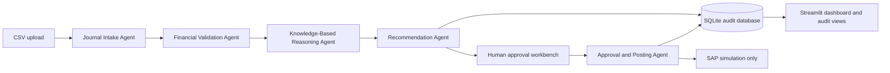

# Architecture

The `FinanceWorkflowOrchestrator` coordinates deterministic agent decisions. Finance rules and master data live in JSON. Guarded SQLite state transitions enforce that only valid, approved entries can be simulated for posting.
