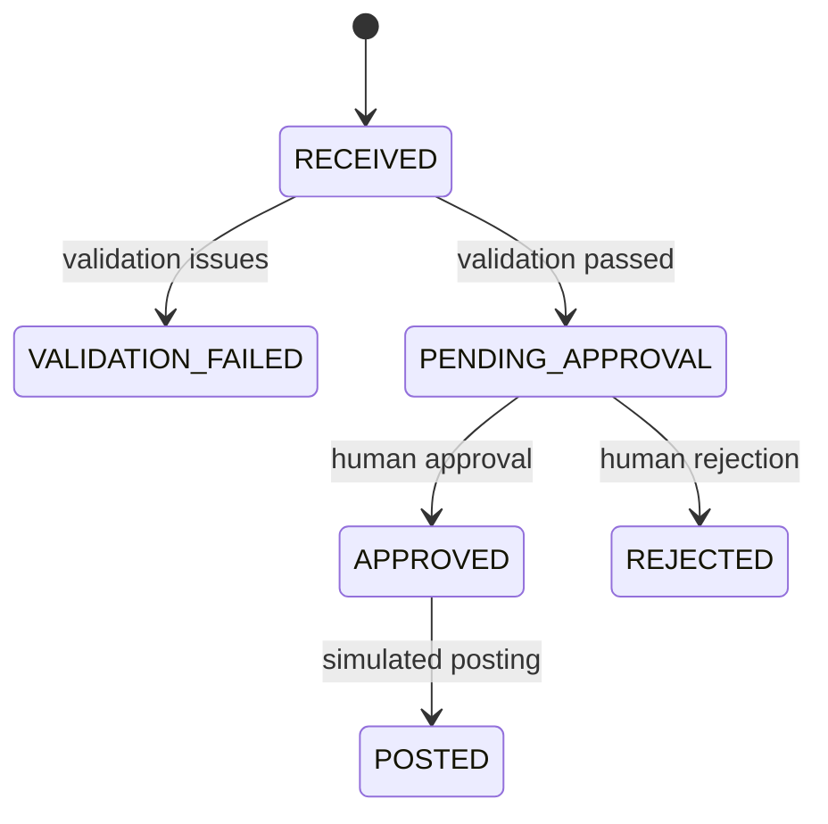

# Project Documentation

## Introduction

This project demonstrates a local finance workflow that reads journal entries from CSV, applies deterministic validation and finance policies, and routes eligible documents for human approval. Posting is simulated and does not connect to SAP.

## Implementation

The intake agent groups CSV lines by document ID and assigns each journal a unique transaction ID. The validation agent checks required values, debit and credit balance, account and cost-centre masters, company codes, duplicates, amount integrity, and cross-company accounts. The knowledge service loads rules and master data from JSON. The reasoning agent matches validation findings to policy explanations, and the recommendation agent derives risk and next actions.

The orchestrator records the resulting state in SQLite. Invalid documents stop in `VALIDATION_FAILED`; valid documents enter `PENDING_APPROVAL`. A user can approve or reject a pending document. Only a valid, approved document can receive a simulated SAP document number. Agent actions, approval decisions, and simulated posting results are stored as audit history.

## State Model

## Academic Summary

The system illustrates knowledge-based reasoning by storing business rules separately from program flow. Validation results match rule identifiers, explanations, and corrective actions. Decision-making is rule-driven, not random or dependent on an external language model. SQLite supports local demonstrations and preserves an audit record of each workflow action.
